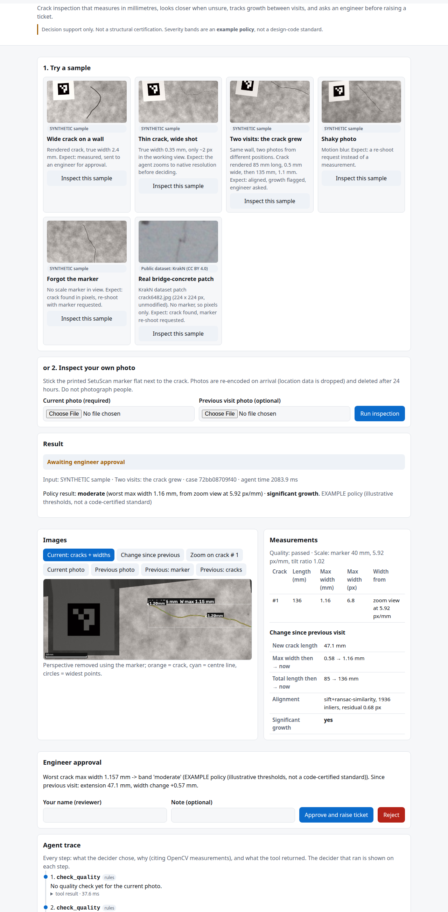

# SetuScan

**Agentic crack inspection with OpenCV 5.** Photograph a crack with a printed marker beside it.
SetuScan:

* measures crack length and width in millimetres;
* takes a closer look on its own when a reading is unreliable;
* compares the photo with a previous visit to detect growth;
* asks an engineer to approve before it raises an inspection ticket.

*Setu* means bridge in Hindi and Sanskrit.

> Decision support only, not a structural certification. Severity bands are an **example policy**.

## Live demo (test it in 2 minutes)

Demo video (4 min): https://youtu.be/aEa8UofuG-c

**https://l4734hezca.execute-api.ap-southeast-2.amazonaws.com** (AWS Lambda container with OpenCV 5.0.0, API Gateway HTTP API, region ap-southeast-2)

1. Open the link. Under "1. Try a sample" press **Inspect this sample** on "Wide crack on a wall" (a SYNTHETIC render). It takes about 2 to 5 s.
2. Read the result: crack width and length in mm, the overlay tabs, and the agent trace (every step, its reason, the decider = rules).
3. The case says "awaiting approval". Enter a reviewer name and press **Approve and raise ticket**. A ticket exists only after that.
4. Try "thin" (the agent zooms to native resolution), "blurry" (re-shoot request), and "growth" (two visits, about 7 s, growth flagged).
5. Or upload your own photo (print `docs/marker-sheet.pdf` at 100 % and put it beside the crack). Do not upload photos of people.

Deep link: `/?sample=growth` runs a sample on load. Health: `/api/health` shows the OpenCV version and runtime. Limit: 20 inspections per 10 minutes per client; the API is throttled to 5 req/s. Cases are deleted after 24 h.

Deliverables: [technical report](docs/TECHNICAL-REPORT.md) ([PDF](docs/TECHNICAL-REPORT.pdf)), [architecture diagram](docs/architecture.png) ([SVG](docs/architecture.svg)), live evaluation [eval/live-aws.md](eval/live-aws.md), demo video (linked in the submission), [Devpost text draft](submission/DEVPOST-FIELDS.md).

## AWS services used

Lambda (container image, 2 GB), API Gateway HTTP API, ECR, S3 (private, 1-day expiry), CloudWatch (logs, dashboard, alarm), SNS (alarm email), IAM (least privilege), CloudFormation, AWS Budgets ($20 limit, alerts at $5/$10/$20).

## What is not done (honest status)

* **No Amazon Bedrock / no LLM.** Bedrock invocation was denied on this account ("Operation not allowed"), so the agent's decider is a deterministic rules policy. An `LLMDecider` exists in code but has never run. The UI and trace say which decider ran.
* **No CloudFront.** Creation needs account verification. The Lambda serves the UI itself over the API Gateway HTTPS URL.
* **No Graviton / COOL build.** The Lambda is x86_64. The COOL award is not claimed.
* **Real-photo millimetre validation is preliminary (2 cracks, 4 photos).** Main accuracy numbers are on SYNTHETIC scenes; detection is shown on the public KrakN dataset. See the real-photo paragraph below.
* Severity bands are an EXAMPLE policy. Decision support only, not a structural certification.
* Two-visit comparison is slow (7 to 7.4 s). Start-up after idle cost 4 to 6.5 s when last measured.

## Build, deploy and test

Requirements: Linux, macOS or WSL, Python 3.12, [uv](https://docs.astral.sh/uv/); for AWS: AWS CLI v2 and Docker.

```bash
uv sync                                  # pinned by uv.lock (opencv-contrib-python-headless==5.0.0.93)
uv run python -m pytest -q                         # 53 tests
# deploy (region ap-southeast-2; the account's organisation policy is region-locked)
scripts/deploy_aws.sh                    # phase 1: ECR image, Lambda, private S3, logs, alarm, dashboard + private smoke test
PUBLIC=1 scripts/deploy_aws.sh           # phase 2: API Gateway HTTP API (public URL)
python3 scripts/smoke_lambda.py          # 7 checks by direct Lambda invocation
python3 eval/eval_live_aws.py            # live evaluation against the public URL (stdlib only, ~25 calls)
CONFIRM=1 scripts/teardown_aws.sh        # remove everything
```

Lambda dependencies are pinned in `requirements-lambda.txt`; the image is built from `Dockerfile.lambda`. Estimated AWS cost for the competition window: under $2.



## What it does

1. **Quality gate.** Too dark, glare, or a featureless frame leads to a re-shoot request with advice.
2. **Scale and sharpness from one printed marker.** ArUco detection (OpenCV objdetect) gives px/mm
   and a homography to the wall plane, which removes perspective. The marker's printed edges also
   give the photo's blur, which is used to reject shaky photos and to blur-correct crack widths.
3. **Crack segmentation and measurement.**
   * Black-hat depth × Hessian ridge detection, with shape and line-symmetry filters.
   * Length from the skeleton contour.
   * Sub-pixel width from perpendicular profiles.
4. **Active perception.** If a crack is under 3 px wide or sits near a policy band edge, the agent
   re-renders that crack at the photo's native resolution and re-measures it. If it still cannot
   decide, it asks for a closer photo.
5. **Two-visit change detection.** SIFT + RANSAC on the rectified wall planes, then the crack
   extension in mm and the width change.
6. **Human approval.** The agent can only *request* approval. Tickets are created only by a named
   engineer's action.

Every step is in a trace that shows which decider chose it (deterministic rules, no LLM),
why, citing the measured numbers, and what the tool returned.

## Results (all from `eval/results/*.json`, reproducible with the scripts in `eval/`)

| Evaluation | Data | Result |
|---|---|---|
| Crack / no-crack detection | KrakN public dataset (CC BY 4.0), **held-out test split**: 2,819 crack / 5,677 background patches | precision **0.852**, recall **0.884**, F1 **0.868**, accuracy 0.911 |
| Width accuracy | **SYNTHETIC** scenes with exact ground truth, 84 scenes | MAE **0.054 mm** overall, measured on the **median** width along the crack (the like-for-like number for a gauge or true width); ≤ 1.5 % median-width error for cracks ≥ 0.8 mm; thin cracks (≤ 0.3 mm) over-read by 0.09–0.16 mm |
| Length accuracy | same synthetic scenes | median absolute error **0.4 %** |
| Marker detection | same synthetic scenes | 82 / 82 when in frame, 0 false detections |
| Agent task success | 14 **synthetic** scenarios × 5 seeds | **69 / 70**; 0 false escalations, 0 missed escalations, 0 error runs |

Live AWS endpoint ([eval/live-aws.md](eval/live-aws.md), re-run 26 Oct 2026 on the final build): 6 of 6 labelled samples gave the expected outcome on every run (15 runs); sample inspections took 1.4 to 3.3 s and the two-visit growth sample 6.4 s (wall time from India, median over all 15 runs 2.5 s); **real uploads** took 4.4 s (one photo) and 8.5 s (two visits, single measurements). A cold start after idle took 4 to 6.5 s in an earlier measurement (this run was warm). The human approval gate, 404, 409 and 415 error paths were checked live.

**Median vs p95.** The accuracy rows use the median width. The app shows both: median and p95 (near-maximum). The severity policy and the overlay headline use p95, so it reads higher by design (wide sample: true 2.4 mm, median 2.41 mm, p95 2.54 mm; growth sample: median 0.49 to 1.08 mm, p95 0.58 to 1.16 mm, true 0.5 to 1.1 mm).

**Real photos (preliminary).** Two cracks in a plaster wall, each shot twice (two sets, 4 photos without the ruler), photographed by the entrant with a printed marker and a steel ruler (0.5 mm steps) as gauge. The printed marker turned out to be about 18 mm, not the nominal 40 mm (measured with the ruler in the same photos), so the evaluation uses 18 mm and says so. Median width vs the ruler's maximum-width reading: crack A 0.78 mm vs 0.7 mm (+11 %), crack B 0.62 mm vs 1.2 mm (-48 %) and 1.13 mm vs 1.2 mm (-6 %); mean absolute error 0.24 mm over the 3 measured photos. In 1 of 4 photos (second shot of crack A) SetuScan found NO crack and closed the case as 'no crack detected', although the crack is visible: a miss, reported as is. The gauge value is a maximum and SetuScan's is a median, so the pairs are not like-for-like (the p95 values are 1.42, 1.63 and 2.22 mm). Crack length is not reliable on this rough plaster (the crack breaks into pieces). n = 4 photos of 2 cracks, phone photos that went through a chat app, ruler resolution about 0.25 mm: these figures describe these photos only and are not an accuracy claim. Files: `eval/real_photos/`, results: `eval/results/real_photos.md`. Run it again with `eval/eval_real_photos.py` and [docs/REAL-PHOTO-PROTOCOL.md](docs/REAL-PHOTO-PROTOCOL.md).

Failure cases are shown in `eval/results/krakn_false_positives.jpg` and
`krakn_false_negatives.jpg`. Limitations are listed in [`docs/TECHNICAL-REPORT.md`](docs/TECHNICAL-REPORT.md) section 7.
Real-photo mm validation has **not** been done yet.

## Run locally

Requirements: Linux, macOS or WSL, Python 3.12, [uv](https://docs.astral.sh/uv/).

```bash
uv sync                                        # pinned deps (uv.lock): opencv-contrib-python-headless==5.0.0.93
uv run python -m pytest -q                               # 53 tests
uv run python scripts/make_samples.py          # demo samples (needs scripts/download_data.py for the KrakN one)
uv run uvicorn setuscan.api:app --port 8765    # open http://127.0.0.1:8765
```

* Deep link to a sample: `http://127.0.0.1:8765/?sample=growth` (also `wide`, `thin`, `blurry`,
  `nomarker`, `krakn`).
* API docs: `/api/docs`.
* Print [`docs/marker-sheet.pdf`](docs/marker-sheet.pdf) at 100 % to try your own photos.

Reproduce the evaluation:

```bash
uv run python scripts/download_data.py         # KrakN from Zenodo, MD5-verified, into data/ (gitignored)
uv run python eval/eval_krakn.py
uv run python eval/eval_synthetic_mm.py
uv run python eval/eval_agent.py
```

## Repository map

| Path | Contents |
|---|---|
| `setuscan/` | pipeline (`quality`, `marker`, `segment`, `measure`, `pipeline`, `compare`, `overlay`), agent (`agent`, `deciders`, `policy`), app (`api`, `store`), synthetic generator (`synth`) |
| `web/` | single-page UI and labelled samples (`web/samples/ATTRIBUTION.md`) |
| `eval/` | evaluation scripts and results ([`eval/README.md`](eval/README.md)) |
| `tests/` | pytest suite |
| `docs/` | [architecture](docs/ARCHITECTURE.md), [technical report](docs/TECHNICAL-REPORT.md), [AWS deployment plan](docs/DEPLOY_AWS.md), marker sheet, screenshots |

## Data and licences

* Code: MIT ([LICENSE](LICENSE)).
* KrakN dataset: Zarski, Wojcik, Miszczak (2021),
  [10.5281/zenodo.5266356](https://doi.org/10.5281/zenodo.5266356), CC BY 4.0. It is used for
  evaluation, and one unmodified patch is shown as a sample.
* Synthetic images are generated by `setuscan/synth.py` and labelled as synthetic wherever they
  appear.

## Disclosure

Built by Harsha Shinde. The code, tests and documentation were written with the help of an AI
coding assistant (Claude Code) under the author's direction and review. The agent inside SetuScan
uses a deterministic rules decider. No large language model is called at run time. Narration: AI text-to-speech voice (Kokoro).


## Deploying your own copy
Set `ALARM_EMAIL=you@example.com` before `scripts/deploy_aws.sh` so the CloudWatch alarm e-mail goes to you (the template default is a placeholder).
