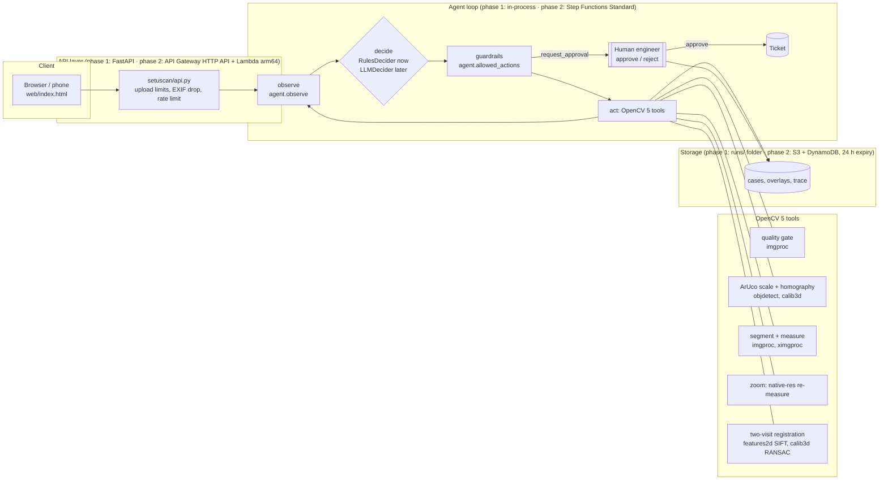

# SetuScan architecture

SetuScan turns one or two phone photos of a crack (with a printed scale marker beside it) into
millimetre measurements, a growth check between visits, and an engineer-approved inspection ticket.
All image analysis is OpenCV 5 (`opencv-contrib-python-headless==5.0.0.93`). An agent loop decides
what to do next from the OpenCV results, and a human approves before any ticket is created.

Phase 1 (this repository today) runs locally. Phase 2 deploys the same code to AWS serverless;
the AWS column below is **planned**, not yet deployed (see `DEPLOY_AWS.md`).

## 1. System diagram



## 2. Agent workflow (perception → decision → action)

```mermaid
flowchart TD
  start([photo(s) uploaded]) --> q[check_quality]
  q -->|dark / glare / featureless| rs1[request_reshoot + advice]
  q -->|ok| m[detect_scale: ArUco + marker-edge blur]
  m -->|marker edges blurred > 2.5 px sigma| rs2[request_reshoot: blurry]
  m --> s[segment_measure: working view]
  s -->|crack but no marker| rs3[request_reshoot: add marker]
  s -->|no crack| close0[close_case]
  s -->|width under 3 px or near a band edge| z[zoom_measure: native resolution]
  z -->|still unresolved at native res and on a band edge| rs4[request_reshoot: move closer]
  z --> cmp
  s --> cmp{previous visit?}
  cmp -->|yes| cv[compare_visits: SIFT + RANSAC]
  cv -->|cannot align| rs5[request_reshoot: same position]
  cv --> cl[classify: EXAMPLE severity policy]
  cmp -->|no| cl
  cl -->|needs engineer: band or growth| ap[request_approval]
  cl -->|monitor| close1[close_case + re-inspection date]
  ap --> human{engineer}
  human -->|approve| ticket[raise_ticket: only via human API call]
  human -->|reject| rej[rejected, reason logged]
```

Every arrow labelled with a condition is a place where an OpenCV measurement changes the next
action. The trace (`case.trace`) records, for each step, the decider that chose it (`rules`,
`llm:<model>`, `rules (fallback: …)` or `human`), its rationale citing the measured numbers, the
allowed actions at that moment, the tool result and the timings.

## 3. Modules

| Module | OpenCV 5 functions doing the work | Purpose |
|---|---|---|
| `setuscan/quality.py` | `Laplacian`, `GaussianBlur`, `connectedComponentsWithStats`, `morphologyEx` | Exposure, glare (ignoring the marker card) and a featureless-frame guard |
| `setuscan/marker.py` | `aruco.ArucoDetector` (objdetect, sub-pixel corners), `findHomography`, `perspectiveTransform`, `remap` | px→mm scale, image→wall-plane homography, **blur sigma measured on the marker's printed edges** (slanted-edge idea) |
| `setuscan/pipeline.py` | `warpPerspective` | Renders a *view*: the whole wall at a bounded working size, or one crack at native resolution (zoom) |
| `setuscan/segment.py` | `morphologyEx(MORPH_CLOSE)` black-hat, `Sobel` Hessian ridge, `connectedComponents`, `convexHull`, `ximgproc.thinning` | Crack mask: dark-depth × ridge cue, hysteresis, shape and line-symmetry filters |
| `setuscan/measure.py` | `ximgproc.thinning`, `findContours`, `approxPolyDP`, `arcLength`, `distanceTransform`, `remap` | Length without staircase bias; sub-pixel width from perpendicular profiles, **blur-corrected** with the marker-measured sigma |
| `setuscan/compare.py` | `SIFT_create`, `FlannBasedMatcher`, `estimateAffinePartial2D` (RANSAC), `findHomography(USAC_MAGSAC)` | Align visit B onto visit A, crack extension and width change |
| `setuscan/overlay.py` | drawing API | Annotated overlays and scale bar |
| `setuscan/agent.py`, `deciders.py`, `policy.py` | — | Agent loop, guardrails, pluggable decider, EXAMPLE severity policy, approval gate |
| `setuscan/api.py`, `store.py`, `web/` | `imdecode`/`imencode` | Local web app; uploads decoded to pixels only (EXIF/GPS dropped), 24 h retention |

## 4. Why these design choices

* **Measure on the wall plane, not the photo.** The marker homography removes perspective, so one
  px/mm holds across the crack. This is valid for cracks coplanar with the marker (flat walls,
  slabs, pier faces) and is listed as a limitation.
* **Use the marker twice.** Its known size gives scale. Its sharp printed edges give the effective
  blur of each rendered view, which is used to correct crack widths for blur
  (`measure.deblur_width`). On synthetic scenes this cut the mean width bias roughly in half (see
  `eval/results/synthetic_mm_accuracy.json`, `work_raw_width_bias_mm_before_blur_correction`
  against `work_width_bias_mm`).
* **Active perception instead of guessing.** The working view is bounded for speed. When a crack
  is under 3 px wide there, or its width sits near a policy band edge, the agent re-renders that
  crack at native resolution and re-measures before classifying.
* **Guardrails outside the decider.** `allowed_actions()` is derived from state, so neither the
  rules nor a future LLM can skip the quality gate, compare unmeasured photos, close a case the
  policy escalates, or raise a ticket. Disallowed proposals are blocked and logged.
* **Classical CV first.** No learned weights are needed to run or deploy. The detector's
  limits are measured on a public dataset (KrakN) and shown with failure cases.
