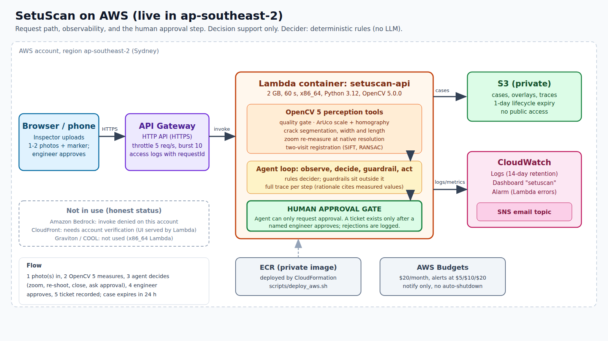

# SetuScan: technical report

*Agentic crack inspection with millimetre measurement, active perception and change tracking, built on OpenCV 5 and deployed on AWS.
Entry by Harsha Shinde for the OpenCV AI Competition 2026, powered by AWS. Final version, 25 Oct 2026.*

* Live application: https://l4734hezca.execute-api.ap-southeast-2.amazonaws.com (AWS Lambda, region ap-southeast-2)
* Code: https://github.com/xexpertai/setuscan (made public by the entrant at submission)
* Status: complete and deployed. Every number below comes from a file in `eval/results/` or `eval/live-aws.json`, generated by the scripts in `eval/`. Synthetic data is labelled SYNTHETIC. The agent's decider is deterministic rules: Amazon Bedrock was denied on this AWS account, so no language model is in the loop, and CloudFront was not available (account verification).



## 1. Problem

Concrete and masonry cracks are usually recorded by eye: a photo, maybe a pencil mark, rarely a
measurement. That makes three things hard:

* **Severity.** Whether a crack is hairline or wide is what decides the next step, and it depends on
  its width in millimetres. A phone photo has no scale.
* **Change.** A crack that is growing matters more than a stable one. Comparing two photos taken
  months apart, from different positions, is hard by eye.
* **Follow-up.** Findings need to reach an engineer, and a human should remain the one who
  decides to act.

Bridge and building failures in India (for example the Morbi suspension bridge collapse,
October 2022) keep structural inspection in public view. SetuScan does not claim it would have
prevented any failure. Its narrower aim is to make routine visual inspection **measured,
comparable over time and auditable**.

## 2. Users

* Junior engineers and inspectors in municipal or public-works departments doing routine visual
  rounds.
* Housing-society committees and school-building safety volunteers who need to decide whether to
  call an engineer.
* Engineers who receive the escalations and approve or reject a ticket.

What users need: a printed A4 marker sheet (`docs/marker-sheet.pdf`) and a phone. No special
hardware.

## 3. Architecture

The figure above shows the deployed system; `docs/ARCHITECTURE.md` has the agent workflow. In short:

1. **Perception tools (OpenCV 5).** Quality gate, ArUco scale and homography, crack segmentation,
   measurement, zoom re-measurement, and two-visit registration.
2. **Agent loop.** observe → decide → act, until a terminal state. The decider is pluggable:
   the deployed system uses a deterministic `RulesDecider`. An `LLMDecider` interface (strict JSON
   validation, falls back to rules) exists in code but is **not wired in and has never run**, because Bedrock invocation was denied. Guardrails
   (`allowed_actions`) are computed from state outside the decider.
3. **Human gate.** The agent can only *request* approval. A ticket is created only by an
   engineer's approve call, which carries the reviewer's name. A reject is logged with its reason.
4. **Trace.** Each step stores the decider that ran, its rationale citing measured values, the
   allowed actions, the tool result and the timings. The UI shows it.

## 4. OpenCV 5 implementation

Version: `opencv-contrib-python-headless==5.0.0.93` (`cv2.__version__ == "5.0.0"`), Python 3.12.

| Step | Method | OpenCV 5 APIs |
|---|---|---|
| Quality gate | exposure histogram fractions; glare = saturated, texture-less blobs (the white marker card is excluded); featureless-frame guard by Laplacian variance | `Laplacian`, `GaussianBlur`, `morphologyEx`, `connectedComponentsWithStats` |
| Scale | ArUco DICT_4X4_50 markers of known printed size (40 and 20 mm), sub-pixel corners; homography from the image to the wall plane in mm | `aruco.ArucoDetector`, `findHomography`, `perspectiveTransform` |
| Blur measurement | **slanted-edge-style** estimate: 36 intensity profiles across the marker's outer black→white edges; the 10–90 % rise distance gives the Gaussian-equivalent sigma (rise = 2.563 σ) | `remap` (bilinear sampling) |
| Views | wall-plane rendering at a bounded working size (≤ 1400 px), or a crack's bounding box at native resolution (zoom) | `warpPerspective` |
| Segmentation | black-hat depth (closing − image) × multi-scale Hessian ridge strength, normalised by robust noise; hysteresis with a contrast floor; shape filters (Feret length, elongation); **centre-line gradient asymmetry** rejects step edges (object outlines) that black-hat alone accepts | `morphologyEx`, `Sobel`, `connectedComponents`, `convexHull`, `ximgproc.thinning` |
| Length | outer contour of the 1-px skeleton, simplified by Douglas–Peucker (ε = 1 px); half the perimeter. This removes the 8-connected staircase bias (tested: a 22.6° line is within 1 %, while the naive chain count over-reads by more than 3 %) | `findContours`, `approxPolyDP`, `arcLength` |
| Width | perpendicular profiles every ~0.5 mm, averaged over 5 parallel lines, baseline-subtracted; equivalent width = area / peak; then **blur-corrected** by inverting `area/peak = w / erf(w / (2√2 σ))`, with σ measured on the marker *in the same view*. Samples below the blur limit are flagged, never extrapolated | `remap`, `distanceTransform` (cross-check) |
| Two visits | both photos rendered on their wall planes at the same px/mm; SIFT on CLAHE-equalised texture outside the card; FLANN + ratio test; similarity transform by RANSAC (homography by USAC MAGSAC when there is no marker); alignment refused unless ≥ 25 inliers, RMS ≤ 3 px and scale within ±10 % | `SIFT_create`, `FlannBasedMatcher`, `estimateAffinePartial2D`, `findHomography(USAC_MAGSAC)`, `createCLAHE` |
| Growth | B's crack mask warped into A's frame; new pixels farther than 1.5 mm from A's cracks are "new crack"; its skeleton length is the extension; width change is compared with 0.10 mm | `warpPerspective`, `dilate`, `bitwise_*` |

## 5. AWS deployment (live, ap-southeast-2)

Deployed with one CloudFormation stack (`infra/template.yaml`) by `scripts/deploy_aws.sh`; teardown with `CONFIRM=1 scripts/teardown_aws.sh`.

| Service | Use |
|---|---|
| ECR (private) | holds the container image built from `Dockerfile.lambda` (Python 3.12, `opencv-contrib-python-headless==5.0.0.93`, pinned in `requirements-lambda.txt`) |
| Lambda | `setuscan-api`, container image, 2 GB, 60 s, x86_64. Runs the FastAPI app (via an ASGI adapter) including all OpenCV 5 work and the agent loop. Serves the UI too. |
| API Gateway (HTTP API) | public HTTPS endpoint, throttled to 5 requests/s (burst 10), access logs with request id |
| S3 (private, encrypted, public access blocked) | case records and overlay images; 1-day lifecycle expiry. A second private bucket exists for UI files and is unused (no CloudFront). |
| CloudWatch | Lambda log group (14-day retention), dashboard `setuscan`, alarm `setuscan-lambda-errors` (any Lambda error) |
| SNS | email topic for the alarm |
| IAM | Lambda role limited to its log group and `GetObject`/`PutObject` on the cases bucket |
| AWS Budgets | `setuscan-monthly` $20, alerts at $5/$10/$20 (actual) and $20 (forecast); notify only, no automatic shutdown |

Responsible operation:
* Uploads are decoded and re-encoded (EXIF/GPS never stored); size limit 12 MB; per-client limit of 20 inspections per 10 minutes inside the app plus the gateway throttle.
* Errors never expose stack traces (generic 500). Tests cover 404, 409, 415 and 429 paths.
* Cases are deleted after 24 h.
* Cost: the account runs on AWS credits; expected spend for the competition window is well under $2. The API Gateway throttle bounds the worst case.

What was **not** possible on this account (stated plainly):
* **Amazon Bedrock:** every Converse call on four Nova model ids returned "Operation not allowed" in ap-southeast-2 (also in several other regions; the account was "being verified"). So the agent decider is rules only.
* **CloudFront:** creation was refused until the account is verified. The Lambda serves the UI itself over the API Gateway HTTPS URL.
* **Graviton / COOL:** not used. The Lambda is x86_64 with the stock OpenCV wheel. The Best Use of COOL award is not claimed.
* Earlier in the project an organisation policy denied compute in every region we first tried; the account turned out to be region-locked to Sydney, where everything above works. The details are in `HANDOFF-AWS.md` and `docs/PLAN-B.md`.

## 6. Evaluation

### 6.1 Crack detection on a public dataset: KrakN (CC BY 4.0)

Data: 224 px patches of concrete bridge surfaces. 4,050 crack and 8,057 background images
after removing 4,007 rotated duplicates. Fixed hash split: 30 % dev, 70 % test. Four detector
parameters and the decision threshold were tuned on **dev only**, and test was scored once.
No learned weights. Score = total centre-line length of crack-shaped components.

| Split | n (crack / background) | Precision | Recall | F1 | Accuracy |
|---|---|---|---|---|---|
| dev (tuning) | 1,231 / 2,380 | 0.866 | 0.904 | 0.885 | 0.920 |
| **test (held out)** | **2,819 / 5,677** | **0.852** | **0.884** | **0.868** | **0.911** |

Test average precision 0.845. Mean runtime 26 ms per patch (p95 50 ms) on an 8-core x86 laptop,
single-threaded per image. Source: `eval/results/krakn_classification.json`.

**Failure cases** (`eval/results/krakn_false_positives.jpg`, `krakn_false_negatives.jpg`):

* False positives:
  * curved dark boundaries of patch repairs or spalls that look like cracks (some are arguably
    label ambiguity);
  * straight object outlines at strong lighting edges (poles, rails), which the asymmetry filter
    reduced but did not remove;
  * strongly blurred background scenery.
* False negatives: very faint hairline cracks with only a few grey levels of contrast against
  speckled surfaces.

A learned segmenter would probably do better on detection. We kept a fully classical detector
because its behaviour is explainable, needs no training data or GPU, and its measured limits are
reported here.

### 6.2 Millimetre accuracy on synthetic scenes (labelled SYNTHETIC)

Real photos with ground-truth widths were only available for 2 cracks late in the project (see the limitations list); the main accuracy study therefore renders
concrete-like walls with exact ground truth:

* procedural texture with pores and stains;
* cracks drawn from an exact distance field;
* the printed marker;
* perspective, rotation, uneven light, optical blur σ = 0.7 px, noise and JPEG.

The grid is 7 widths × 3 camera resolutions (4, 7, 12 px/mm) × 4 seeds = 84 scenes.

* **Marker:** found in 82 of 82 scenes where it was inside the frame; 0 false detections.
* **Length** (sum of detected cracks vs the visible ground-truth centre line): median absolute
  error 0.4 %, mean 1.4 %.
* **Width** (median along the crack, working view; this is the metric behind every accuracy figure in this report. The app and the severity policy also use the p95 width, a near-maximum that reads higher than the median, for example 2.54 mm against a median of 2.41 mm on the 2.4 mm wide sample):

| True width (mm) | n | Bias before blur correction (mm) | Bias after (mm) | MAE after (mm) | MAPE after |
|---|---|---|---|---|---|
| 0.2 | 12 | +0.273 | +0.162 | 0.163 | 81.5 % |
| 0.3 | 12 | +0.200 | +0.090 | 0.099 | 33.1 % |
| 0.5 | 11 | +0.120 | +0.049 | 0.050 | 9.9 % |
| 0.8 | 12 | +0.032 | +0.007 | 0.012 | 1.5 % |
| 1.2 | 12 | −0.001 | −0.006 | 0.011 | 1.0 % |
| 2.0 | 12 | −0.009 | −0.009 | 0.018 | 0.9 % |
| 3.0 | 11 | −0.018 | −0.018 | 0.021 | 0.7 % |

Overall MAE is 0.054 mm. Mean bias is +0.040 mm after blur correction, against +0.086 mm before.

How error depends on resolution: when the true width spans at least about 2.5 px in the measuring
view, errors are under 5 %. Narrower cracks are over-read, which is the conservative direction
(it can only push a crack up a band, towards more review). This is why the agent:

* treats widths under 3 px as unreliable and re-measures them at native resolution;
* asks for a closer photo if the reading is still unresolved and sits on a policy band edge.

By camera resolution, MAPE is 37.5 % at 4 px/mm, 13.7 % at 7 px/mm and 3.8 % at 12 px/mm, so
closer photos help most. Source: `eval/results/synthetic_mm_accuracy.json`.

### 6.3 Agent task evaluation (SYNTHETIC scenarios, rules decider)

14 scenarios × 5 seeds = 70 runs. Each has an expected terminal state and a required or
forbidden action. Source: `eval/results/agent_scenarios.json`.

| Metric | Result |
|---|---|
| Task success (status and action checks) | 69 / 70 (98.6 %) |
| False escalations (engineer asked when the expected outcome was to close) | 0 % |
| Missed escalations | 0 % |
| Runs ending in an error state | 0 |
| Mean steps per case / mean wall time | 5.1 steps / 3.0 s |

Scenario details:

* All 5 dark, 5 glare, 5 blurred (caught by the marker-edge blur) and 5 no-marker runs ended in a
  re-shoot request **before** any measurement was used.
* All 5 blank images were handled without errors.
* All 5 unrelated-wall pairs were refused alignment.
* All 5 growth pairs were escalated, and all 5 stable pairs were closed.

Active perception example ("thin crack, wide shot", true width 0.35 mm, 5 seeds): the working
view read 0.39–0.44 mm. The agent zoomed to native resolution and re-measured 0.39–0.40 mm before
classifying.

The one failure is a 0.18 mm hairline only 1.6 px wide even at native resolution. Its blurred
reading fell on the 0.3 mm band edge, so the agent asked for a closer photo instead of closing.
We report it as a failure against the scripted expectation, though it is the designed
conservative behaviour.

Unit tests: 53 pytest tests covering measurement maths, marker scale and blur, the de-blur
inversion, comparison, quality gate, policy, agent guardrails and the LLM fallback, and the API.

### 6.4 Live AWS endpoint evaluation

Run against the public URL with `eval/eval_live_aws.py` (26 Oct 2026, final build, 23 API calls, from a laptop in India, so wall times include the round trip to Sydney). Full tables: `eval/live-aws.md`; raw data: `eval/live-aws.json`. All inputs are the labelled sample set (SYNTHETIC renders plus one unmodified KrakN patch); no real-photo data was used.

| Sample | Expected outcome | Live outcome | Wall time, median (min to max) |
|---|---|---|---|
| wide | awaiting_approval | match, 3 of 3 runs | 2.6 s (2.5 to 2.8 s) |
| thin | closed | match, 3 of 3 | 3.3 s (3.2 to 3.3 s) |
| blurry | needs_reshoot | match, 3 of 3 | 1.5 s (1.5 to 1.6 s) |
| nomarker | needs_reshoot | match, 2 of 2 | 2.5 s (2.4 to 2.5 s) |
| krakn | needs_reshoot | match, 2 of 2 | 1.4 s (1.4 to 1.5 s) |
| growth (two visits) | awaiting_approval | match, 2 of 2 | 6.4 s (6.4 to 6.4 s) |

* All 6 samples gave the expected status on every run; every step was decided by the rules decider.
* Real uploads: one photo 4.4 s, two visits (SIFT + RANSAC alignment) 8.5 s, single measurements each. They are slower than the sample runs because the image bytes travel from India to Sydney and are decoded server-side.
* This run was warm. A cold start after idle took about 4 s (first request) to 6.5 s (first inspection) in an earlier run on the previous build.
* The human gate was exercised live: no ticket before approval, a ticket after approval by a named reviewer, a second approval refused (HTTP 409), unknown sample 404, non-image upload 415, unknown case 404.
* Median versus p95 on the live app: wide sample true 2.4 mm, median 2.41 mm, p95 2.54 mm; thin sample true 0.35 mm, median 0.37 mm, p95 0.41 mm; growth sample median 0.49 to 1.08 mm, p95 0.58 to 1.16 mm (true 0.5 to 1.1 mm).
* One client, one region, sequential requests: this is not a load test (the API is throttled to 5 requests per second by design).

## 7. Limitations

* **Real-photo mm validation is preliminary (2 cracks, 4 photos).** Two cracks in a plaster wall, each shot twice (two sets, 4 photos without the ruler), photographed by the entrant with a printed marker and a steel ruler (0.5 mm steps) as gauge. The printed marker turned out to be about 18 mm, not the nominal 40 mm (measured with the ruler in the same photos), so the evaluation uses 18 mm and says so. Median width vs the ruler's maximum-width reading: crack A 0.78 mm vs 0.7 mm (+11 %), crack B 0.62 mm vs 1.2 mm (-48 %) and 1.13 mm vs 1.2 mm (-6 %); mean absolute error 0.24 mm over the 3 measured photos. In 1 of 4 photos (second shot of crack A) SetuScan found NO crack and closed the case as 'no crack detected', although the crack is visible: a miss, reported as is. The gauge value is a maximum and SetuScan's is a median, so the pairs are not like-for-like (the p95 values are 1.42, 1.63 and 2.22 mm). Crack length is not reliable on this rough plaster (the crack breaks into pieces). n = 4 photos of 2 cracks, phone photos that went through a chat app, ruler resolution about 0.25 mm: these figures describe these photos only and are not an accuracy claim. Files: `eval/real_photos/`, results: `eval/results/real_photos.md`. The main width accuracy is still shown on synthetic scenes.
  images. A small real set is planned: marker photos of real cracks with crack-gauge or ruler
  readings.
* Scale is valid only on the marker's plane. Curved surfaces, corners and cracks that are not
  coplanar with the card are not measured correctly.
* Cracks narrower than about 2.5 px in the best available view are over-read. Hairline widths
  need close-up photos.
* Detection is classical: on KrakN, about 1 in 7 flagged patches is a false positive (repair
  edges, object outlines) and about 1 in 9 cracks is missed (very faint hairlines).
* Two-visit comparison needs enough surface texture for SIFT. Very smooth painted walls may fail
  alignment, and the agent then asks for a re-shoot rather than guessing.
* The severity bands are an **example policy**, not values from a design code.
* The deployed agent has no language model (rules only), no CloudFront, and no Graviton build, for the account reasons in section 5.
* Latency: a start after idle cost 4 to 6.5 s in the earlier cold-start measurement, and a two-visit comparison takes 7 to 7.4 s in the latest live run. Throughput is limited to 5 requests/s by design.

## 8. Responsible use

* **Decision support, not certification.** The UI, report and every ticket state this. The policy
  is labelled EXAMPLE everywhere.
* **Human in control.** No code path creates a ticket without a named engineer's approval.
  Rejections are recorded. Disallowed actions proposed by any decider are blocked and logged.
* **Honest labelling.** Samples are labelled SYNTHETIC or "Public dataset: KrakN (CC BY 4.0)". The
  UI and trace show which decider ran (rules, no LLM).
* **Privacy.**
  * Uploads are decoded to pixels and re-encoded, so EXIF metadata including GPS is never stored.
  * Cases are deleted after 24 h.
  * The UI asks users not to photograph people.
  * No face or person processing exists in the code.
* **Safety.** The marker sheet tells users to photograph only what they can reach safely from the
  ground.
* **Data rights.**
  * KrakN is used under CC BY 4.0 with attribution.
  * SDNET2018 was not used because it could not be downloaded without bypassing a browser check.
  * All synthetic data is generated here.
* **AI assistance.** The code and docs were written with an AI coding assistant (Claude Code) under
  the entrant's direction. This is disclosed in the README.
  Narration in the demo video: AI text-to-speech voice (Kokoro).

## 8a. Reproducibility

```bash
uv sync                                    # pinned by uv.lock (opencv-contrib-python-headless 5.0.0.93)
uv run python -m pytest -q                           # 53 tests
uv run python scripts/download_data.py     # KrakN, MD5-verified
uv run python eval/eval_krakn.py && uv run python eval/eval_synthetic_mm.py && uv run python eval/eval_agent.py
uv run uvicorn setuscan.api:app --port 8765
```
